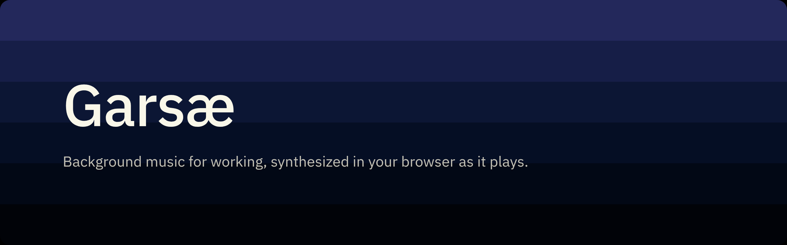
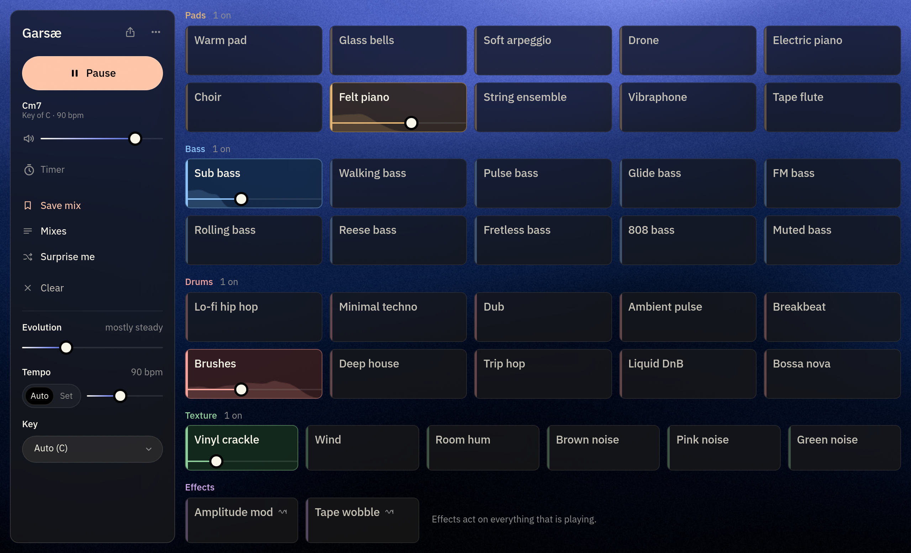
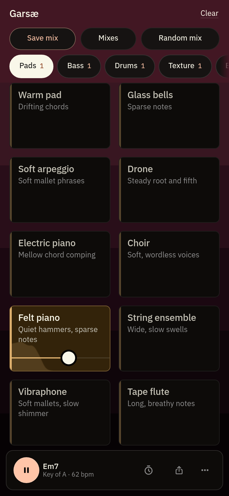

<p align="center">
  
</p>

<p align="center">
  <a href="https://garsae.ranonis.lt/"></a>
  <a href="https://github.com/PijusRan/garsae/actions/workflows/deploy.yml"></a>
</p>

> [!CAUTION]
> **All of the code in this repository was written by AI** (Claude, through Claude Code). The design decisions and direction are human; the implementation is not.

Endless, generative focus music in the browser. Toggle instrument tiles, mix their levels, and let it run in the background. Every sound is synthesized live with the Web Audio API, so nothing repeats. See [DESIGN.md](DESIGN.md) for the full design.

<p align="center">
  
  &nbsp;
  
</p>

## Features

| | |
| --- | --- |
| **Tiles** | 38 instruments you switch on and mix, each with its own level |
| **Surprise me** | Builds a new mix that always has a harmonic bed under it |
| **Evolution** | One slider for how far the music drifts, from fixed to restless |
| **Tempo and key** | Set them yourself; every tile follows |
| **Mixes** | Save mixes on your device, or start from a starter mix |
| **Share links** | The whole mix lives in the link, so there is nothing to sign up for |
| **Session timer** | Fades the music out and stops when your time is up |
| **Offline** | Installable, and it can download itself to run with no connection |
| **Languages** | English and Lithuanian, following your browser until you pick one |

## Instruments

No samples and no recordings: all of it is plain Web Audio nodes, mastered live to about -17 LUFS.

| Category | Tiles |
| --- | --- |
| **Pads** | Warm pad, Glass bells, Soft arpeggio, Drone, Electric piano, Choir, Felt piano, String ensemble, Vibraphone, Tape flute |
| **Bass** | Sub bass, Walking bass, Pulse bass, Glide bass, FM bass, Rolling bass, Reese bass, Fretless bass, 808 bass, Muted bass |
| **Drums** | Lo-fi hip hop, Minimal techno, Dub, Ambient pulse, Breakbeat, Hand drums, Deep house, Trip hop, Liquid DnB, Bossa nova |
| **Texture** | Vinyl crackle, Wind, Room hum, Brown noise, Pink noise, Green noise |
| **Effects** | Amplitude mod, Tape wobble |

## Run

```bash
npm install
npm run dev        # http://localhost:5173
npm run build      # static site in dist/
npm run preview    # serve the build locally
```

Pushes to `main` deploy to GitHub Pages through `.github/workflows/deploy.yml`, once Settings → Pages → Source is set to GitHub Actions. `dist/` also works on any other static host (Vercel, Netlify, Cloudflare Pages). There is no backend. The build uses relative paths, so it also works from a sub-folder.

## Checks

```bash
npm run typecheck
npm run smoke                  # renders every tile offline in headless Chromium and prints loudness, peaks, clipping
npm run smoke -- --wavs        # also writes listening WAVs to smoke-output/
npm run smoke -- --compare     # tiles with an alternate voice: loudness of each against its own, and the trim to match
npm run build && npm run ui-check   # drives the built app: play, toggle, share link, phone layout, screenshots
```

`smoke` and `ui-check` need Chromium. Set `CHROME_PATH` if it is not at `/usr/bin/chromium-browser`.

## Faust voices

Eleven tiles play on Faust, written in [Faust](https://faust.grame.fr) and run as WebAssembly in an AudioWorklet. Physical models for tape flute (the STK jet-driven waveguide flute, blown softly), string ensemble (Faust's bowed violin string, six desks moving legato), choir (FOF formant voices, sung softly), felt piano (a felt hammer on stiff-string modes, unison pairs that beat, a damper), glass bells (a struck free bar's modes), walking bass (a plucked upright in commuted synthesis: the finger through the body's resonances into a waveguide string), muted bass (a flatwound string damped by foam) and 808 bass (the TR-808's bridged-T circuit tuned to the note). Drum kits for lo-fi, minimal techno, dub, ambient pulse and trip hop, each built from the drums its genre is played on (`faust/dsp/garsae_drums.lib`: modal membranes and bars, wired snares, a PhISEM shaker, models of the TR-808 and TR-909 circuits, sampler grit where the genre was made on samplers). Each pitched model was tuned by measuring the pitch it actually plays at 44.1 and 48 kHz and correcting for it, and each voice and kit trimmed to the loudness of the synth version it replaced. The tile's generator decides every note and hit; the model only plays it. The models load in the background as the page opens, and are part of the offline download.

```bash
npm run faust      # recompiles src/engine/faust/dsp/*.dsp into src/engine/faust/gen/ (no Faust install needed)
npm run compare    # listening tests: a tile's own voice (A) against its alternates (B, C, ...), on the same notes
```

`npm run compare` opens a dev-only listening page. Each tile with alternates in `src/engine/alternates` plays what it ships with (A) and every alternate (B, C, …) side by side at the same loudness: voices and kits on the very same notes, whole generators writing their own. Space steps through them, letters pick one, and a blind mode shuffles and hides them. Tiles are grouped by listening round, the newest open and marked to test, with what to listen for: round 3 keeps the soft arpeggio's old writer (a new figure every bar) against the motif it ships with, and rounds 1 and 2 keep the synth voices and kits the Faust tiles replaced and the round 2 candidates that were not chosen. To test a new candidate, add it there in the next round and set its trim with `npm run smoke -- --compare`. Neither the page nor the alternates are part of the app.

The Faust libraries are LGPL with an exception for generated code; the compiler is only a dev dependency.

## Layout

```
src/
  tiles.ts                 tile catalogue (names, categories, default volumes, loudness levels)
  engine/                  audio engine: plain TypeScript, no UI framework
    engine.ts              public commands: start, stop, setTile, setTileVolume, setEvolution, setBpm, setKey, setModulation
    scheduler.ts           0.8 s look-ahead scheduler, ticked by clock.worker.ts
    chords.ts, theory.ts   hidden chord engine (Dorian) and melodic scale (minor pentatonic)
    evolution.ts           how the Evolution slider maps to mutation, chord swaps, movement and density
    master.ts              mix bus, reverb, tape wobble, amplitude modulation, limiter
    params.ts              glide() helper (no direct .value writes), envelopes
    synth.ts               shared sound design: ensemble chorus, analog pitch drift, saturation
    instruments/           pads, keys, bass, atmosphere and noise colours, effect tiles
    drums/                 synthesized drum voices, genre patterns and mutation rules
    faust/                 physical models: Faust sources (dsp/), compiled modules (gen/), the AudioWorklet runner
    models/                the model voices: loading, voice allocation, level trims, A/B hook
    alternates/            candidate voices, drum kits and generators for listening tests, by round (dev-only, compare.html)
  state/mix.ts             mix model, share-link encoding, saved mixes, Surprise me
  i18n/                    English and Lithuanian strings
  App.tsx, ui/             Preact UI and PWA helpers
public/sw.js               service worker, only used after "Download for offline"
```

## Design notes

<details>
<summary><strong>Decisions on the open questions</strong></summary>

- **Mutation timing.** Drums consider a mutation every 8 bars at low Evolution and every 2 bars at full Evolution. The chance rises from 30% to 100%, and one mutation makes 1 to 3 small edits. At Evolution 0 nothing mutates and chords never change. A soft track that drifts far from its base pattern is pulled back over time. A fill can replace the last beat of each 4-bar phrase.
- **Chord swaps.** After each pass of the 4-chord loop, one chord may be swapped. The chance goes from 10% to 100% across the slider. Distance is measured by shared notes, so low Evolution only picks chords that share 3 of 4 notes. The home chord in slot 1 moves rarely, and the diminished vi chord is never used.
- **Generators.** The chord pad holds close voicings for the whole chord with slow attack and release. Bells play sparse struck-bar notes that move step-wise in the pentatonic scale. The soft arpeggio plays one short broken-chord phrase per bar (chord tones snapped to the pentatonic, between G3 and D5), on calm rhythms from quarters and dotted quarters to a few eighths. Each phrase rises, falls or arches, starts near where the last one ended and fades towards its end, and some bars rest; Evolution allows busier rhythms and fewer rests. A quiet, dark dotted-quarter echo trails behind it. Sub bass holds the chord root. Walking bass plans each bar from where it must land: beat 1 on the chord, beats 2 and 3 moving towards the next downbeat, beat 4 approaching it by a half step, a scale step or its fifth above; a two-feel when calm, four beats with the odd ghosted skip when livelier. Pulse bass plays steady eighths. The electric piano comps rolled chord voicings (sometimes rootless) on downbeats and sparse offbeats. The choir holds the chord in four voices and changes vowel (oo, oh, a dark ah) on some chord changes. Glide bass is one monophonic line per bar that slides between root, fifth and octave and steps into the next chord. FM bass plays a relaxed two-feel: long notes on 1 and 3 (beat 3 sometimes rests or takes the fifth), with an occasional short octave or fifth on the "and" of 2 or 4, and a step into the next chord's root. Rolling bass repeats one of four syncopated one-bar riffs on root, octave and fifth, and Evolution swaps the riff.
- **Hand drums.** A calm conga tumbao: heel and toe murmuring through the bar, a slap on 2, and two open tones on 4 and its "and", the second on the low tumba. A high quinto wanders on top (the part that mutates), with a frame drum underneath and a soft shaker on the eighths.
- **Breakbeat.** Fast and tight, as electronic music plays breaks: at calm tempos (up to 90 bpm) the break runs at double time, 120-180 bpm. Near-quantized (no swing, ±0.5 ms), a short punchy kick, a crisp snare, short hats, then a hard, fast bus compressor and saturation, left bright. It plays the Amen and three other standard breaks (a two-step, a ghost-noted funk break and a straight big beat), may change break every four bars (more often with Evolution), and may end a phrase with a snare roll, a stutter or a drop before the downbeat.
- **Ambient pulse.** It is a soft heartbeat: a muffled low thump on beats 1 and 3, a breathy shaker on the eighths, and an occasional soft tom. It has no snare.
- **Surprise me guardrails.** Every surprise mix has a harmonic bed, picked evenly from warm pad, drone, choir, or a soft arpeggio, glass bells or electric piano over a bass, and at most 6 tiles. It picks at most one extra melodic layer, one bass, one drum genre, one atmosphere and one noise colour. Breakbeat and techno are rarer and quieter. Effect tiles are never picked, and Evolution stays between 0.15 and 0.5.
- **Focus presets.** These are not built yet, because the design puts them after the prototype. The engine already exposes amplitude modulation rate and depth through `setModulation`, and the AM tile uses it at 16 Hz.
- **Generative textures.** Tape wobble adds gentle wow and flutter to the whole mix, and drones have their own tile. The Experimental category (binaural, isochronic, granular cloud) was removed.
- **Sound design.** Plain oscillators sound like an old game, so every voice borrows a standard studio-synth recipe. The electric piano is DX7-style FM (algorithm 5: a body pair and a 14:1 tine pair that fades fast) with a suitcase tremolo. The glide bass runs through two cascaded lowpasses (24 dB, Moog-like), and the FM bass is the DX7 electric-bass recipe: a sine with a 1:1 modulator whose index drops quickly after each note. The congas are struck membranes: a fundamental that settles a few percent in pitch, overtones at a skin's 1.52 and 2.24 times (fading first) and a muffled palm thud; the slap is a pop of mid-high noise over the skin's overtone. The warm pad stacks three detuned, drifting saws per note through a filter that opens with the swell and a Juno-style ensemble chorus. The arpeggio is a felt-mallet marimba (partials at 1, 4 and 9.8 times the fundamental, low notes ringing longer, a soft wooden knock). The drone is built to sit still: soft flute-organ tones on the root, a just fifth and the octaves (so nothing beats), in the tenor register rather than the sub-bass, with no pitch drift or chorus. Only the upper voices move, each swelling on its own slow breath-paced cycle. The pulse bass is two detuned saws, gently saturated. The kick has a beater click and soft drive, the snare has two shell modes plus wires, and the hats use the TR-808's six square-wave metal cluster. No samples anywhere: these are plain Web Audio nodes, and the tiles under Faust voices are modelled.
- **Volume curve.** Sliders map to gain as volume squared. Each tile also has a loudness level, calibrated with `npm run smoke` so that tiles sound roughly equally loud at the same slider position.
- **Last mix.** The current mix is remembered in browser storage and restored on the next visit. A share link takes priority over it.

</details>
